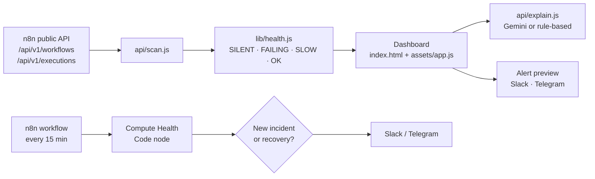

<div align="center">

<h1>Flow Health Monitor</h1>

<p>Catch silent, failing and slow n8n workflows before your clients do.</p>

<p>
  <a href="https://flow-health-monitor.vercel.app"></a>
  <a href="#n8n-workflow"></a>
  <a href="LICENSE"></a>
  
  
</p>

<p>
  <a href="https://flow-health-monitor.vercel.app"><b>Live demo</b></a> ·
  <a href="#n8n-workflow"><b>n8n workflow</b></a> ·
  <a href="#how-it-works"><b>Architecture</b></a> ·
  <a href="#run-locally"><b>Run locally</b></a>
</p>

</div>

## Overview

Errors are loud. The workflow that quietly stops running for three days is the one that costs a client money, because nothing alerts anyone. Flow Health Monitor reads workflows and recent executions from n8n instances, flags flows that went silent, keep failing, or got slow, explains each incident in plain English, and previews the Slack or Telegram alert it would send.

## Highlights

- **Three clear health rules.** SILENT, FAILING and SLOW, computed by one dependency-free engine shared by the dashboard, the API and the n8n Code node.
- **Silence detection that knows the schedule.** The expected interval is read from the Schedule Trigger, Cron or Interval node, or inferred from run gaps for webhook flows.
- **Plain-English incident write-ups.** Gemini 2.0 Flash when `GEMINI_API_KEY` is set, otherwise a deterministic rule-based explainer, with headline, likely cause, impact and next steps.
- **Live scan of any public instance.** Paste an n8n base URL and API key; the key is used for that request only and is never stored or logged.
- **Alerts once per incident.** The included n8n workflow keeps state in workflow static data and posts again only on a new status or recovery.
- **Works with no keys.** Demo mode ships 10 sample workflows across 2 fictional client instances.

## How it works



1. `/api/scan` pages through up to 500 workflows and 1,000 recent executions, then tops up quiet flows with per-workflow calls.
2. Active workflows, plus inactive ones that ran in the last 7 days, are kept (max 150). Error messages and failing node names are fetched for up to 8 failing flows.
3. `lib/health.js` scores each flow and sorts worst first: FAILING, SILENT, SLOW, OK.
4. Opening an incident calls `/api/explain` for a summary, likely cause, business impact and three next steps.
5. The n8n workflow runs the same rules on a schedule and alerts on new incidents and recoveries only.

### Health rules

| Status | Rule |
| --- | --- |
| SILENT | No successful run within 2× the expected interval, and recent errors don't explain the gap |
| FAILING | 3 or more consecutive errors on the most recent finished runs |
| SLOW | Latest run took more than 3× the median of earlier successful runs (needs 5+ successes) |
| OK | Running on cadence. Flows with no detectable schedule skip the silence check |

## Tech stack

| Layer | Tools |
| --- | --- |
| Frontend | Static HTML, CSS, vanilla ES modules |
| API | Vercel serverless functions (Node 18+, native `fetch`, no dependencies) |
| AI | Google Gemini 2.0 Flash (optional), rule-based fallback |
| Data source | n8n public API (`X-N8N-API-KEY`) |
| Automation | n8n: Schedule Trigger, HTTP Request, Code, IF, Slack, Telegram |

## Project structure

```
flow-health-monitor/
├── index.html                 Dashboard shell
├── assets/
│   ├── app.js                 Dashboard logic, drawer, alert preview, connect form
│   └── style.css
├── api/
│   ├── scan.js                POST: live n8n scan · GET or empty body: sample data
│   └── explain.js             POST: incident write-up · GET: { aiAvailable }
├── lib/
│   ├── health.js              Health engine and schedule parsing (shared)
│   ├── explain-demo.js        Rule-based incident explainer
│   ├── sample.js              Deterministic sample data
│   └── http.js                Rate limiting, JSON body reader, response helper
├── n8n/
│   └── flow-health-monitor.n8n.json
├── vercel.json
└── LICENSE
```

## Run locally

```bash
git clone https://github.com/Saitarun29/flow-health-monitor.git
cd flow-health-monitor
npx vercel dev
```

Open http://localhost:3000. Demo mode needs no keys. Click **Connect n8n** to scan a live instance.

## Configuration

All variables are optional.

| Variable | Required | Purpose |
| --- | --- | --- |
| `GEMINI_API_KEY` | No | Enables live AI write-ups in `/api/explain`. Without it, or if the call fails, the rule-based explainer is used |
| `ALLOW_PRIVATE_HOSTS` | No | Set to `1` so `vercel dev` can scan a local n8n such as `http://localhost:5678`. Never set it in production |

Built-in limits: 20 scans and 30 explain calls per minute per IP, 8 s timeout per n8n request, 12 s timeout for Gemini. Private and local addresses are blocked from the cloud.

## n8n workflow

File: [`n8n/flow-health-monitor.n8n.json`](n8n/flow-health-monitor.n8n.json)

1. In n8n, go to **Settings → n8n API** and create an API key.
2. Set the environment variables `N8N_BASE_URL` (for example `https://n8n.acme.com`) and `N8N_API_KEY`. Add `TELEGRAM_CHAT_ID` if you use the Telegram node.
3. Import the JSON, connect Slack on **Slack alert** (channel `#client-alerts`), and optionally enable **Telegram alert**.
4. Edit the **Settings** node (client label, thresholds, ignored IDs, interval overrides for webhook flows), then activate. Static data only persists on active runs, not manual tests.

Run it on a different instance than the one it watches, so it can still alert if that instance goes down.

## Deploy

[](https://vercel.com/new/clone?repository-url=https://github.com/Saitarun29/flow-health-monitor)

Static files and the `api/` functions deploy as is. Add `GEMINI_API_KEY` in project settings to turn on live AI.

---

<div align="center">

Built by **Sai Tarun Ronanki** · AI Systems & Agentic Workflows Builder · Hyderabad

[saitarun.com](https://saitarun.com) · [LinkedIn](https://linkedin.com/in/ronanki-sai-tarun) · [X](https://x.com/SaiTarunRonanki)

**[Discuss your workflow →](https://wa.me/918008941430?text=Hello%20Sai%20Tarun%20Ronanki,%20I%20want%20to%20discuss%20about%20my%20workflow)**

MIT © 2026 Sai Tarun Ronanki

</div>
